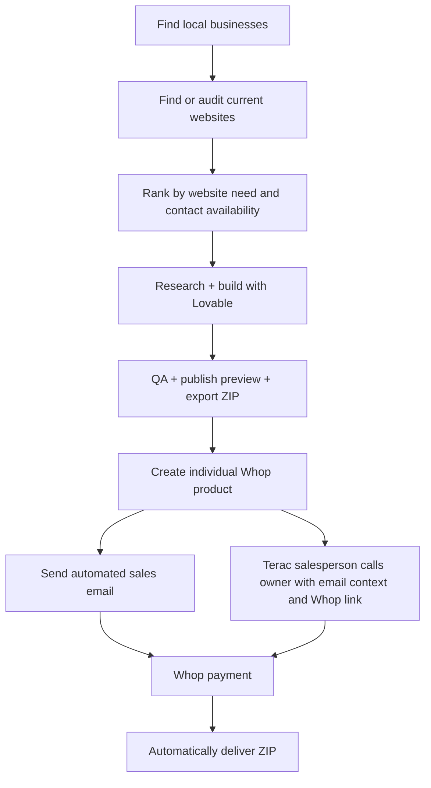

# Sidewalk AI — Hackathon Build Spec

**Version:** 3.0 — hackathon-only scope
**Working name:** Sidewalk AI  
**Goal:** Build an autonomous website agency that really discovers local businesses, evaluates website opportunities, builds a better site, lists that specific website as a product on Whop, sends a sales email and recruits a Terac salesperson to call a real business contact, accepts payment through Whop, and automatically delivers the website source as a `.zip`.

> **Pitch:** “An AI web agency with zero employees. It finds businesses that need websites, builds them a working one, lists each site for sale, and automatically delivers the code when they buy.”

## 1. Strict scope

The app must perform this exact, real sequence:



**Every box is a real integration/action.** No generated leads, fake website screenshots, placeholder Whop pages, simulated sales calls, or dummy fulfillment successes.

**Explicitly excluded:** Stripe integration; domain connection or transfer; buyer account creation; client portal; subscriptions and maintenance; follow-up campaigns; automated AI voice calling; custom site editor; ownership verification workflow; post-hackathon roadmap. We are **selling a downloadable website codebase**, not promising to operate its future hosting.

## 2. Main user flow

### Agent/operator

1. Enter a neighborhood/city, business category, search radius, and maximum number of builds.
2. Click **Start autonomous run**.
3. Watch real businesses populate the dashboard with status: `No website`, `Poor website`, `Good website`, or `Needs review`.
4. See website scores, evidence, rank, estimated sale price, build cost, and expected-profit estimate.
5. Watch the agent choose qualified businesses and build their sites through Lovable.
6. Inspect actual new preview URLs, Whop product pages, Terac sales-task status, sales and ZIP-delivery status.

### Business recipient

1. Receives a sales email and a human sales call describing an **unofficial website concept** created for their business.
2. Clicks the preview link and sees the functioning, fully designed site.
3. Clicks the **specific Whop product page** for that exact website.
4. Completes one-time payment directly through **Whop**.
5. Automatically receives a secure download link to a ZIP containing the website code and deployment instructions.
6. Can run/deploy the site independently. No account handoff, domain setup, or post-sale service is part of the hackathon deliverable.

## 3. Discovery, website detection, and ranking

### Discovery

- **Google Places API (New):** Search by area/radius and types (`cafe`, `restaurant`, `bakery`, etc.). Retrieve unique place ID, name, business type, operating status, and website URL as needed. Use narrow field masks to control cost.
- **Exa Search + Contents:** Independently search for an official website, publicly posted menu, and a business-controlled public phone and email.
- **Website existence check:** `websiteUri` missing from Google is only a clue. Exa may find a real website that Google omitted.
- **Deduplication:** Unique place ID first, fallback normalized business name/address/URL. Ignore closed businesses, chains where inappropriate, and duplicates.

**Provider constraint:** Google Places data has caching/storage and attribution restrictions. Persist permitted identifiers and your own derived audit results; obtain lasting menu/contact facts from independently permitted sources. Do not build a permanent scraped Google directory.

### Website classification

| Classification | Logic                                                         | Action                    |
| -------------- | ------------------------------------------------------------- | ------------------------- |
| `NO_WEBSITE`   | No legitimate official site after Places + Exa cross-check    | High-priority candidate   |
| `POOR_WEBSITE` | Site exists, score `< 75/100` or at least one measured defect | High-priority candidate   |
| `GOOD_WEBSITE` | Site score `>= 75/100` with no measured defects               | List, but do not generate |
| `NEEDS_REVIEW` | Site/source inaccessible, ambiguous or insufficient evidence  | List, but do not generate |

### Explainable score (0–100, higher = better)

| Criterion                         | Weight | Measurement                                        |
| --------------------------------- | -----: | -------------------------------------------------- |
| Mobile responsiveness             |     25 | Playwright mobile viewport, overflow/layout checks |
| Navigation / menu / contact       |     25 | Presence and usability of key business information |
| Functional links and availability |     20 | HTTP checks, HTTPS, broken links                   |
| Performance                       |     15 | Lighthouse/mobile measurements                     |
| Design quality                    |     10 | LLM rubric grounded in an actual screenshot        |
| Basic SEO                         |      5 | Title, description, headings                       |

For `NO_WEBSITE`, display **N/A** for the website score, not an invented `0/100` measurement. It still gets maximum website-opportunity priority.

### Price, costs and lead priority

Display the quoted sale price and estimated research, build and sales costs. Reserve estimated provider spending against the run cap. Costs are informational and never exclude a lead based on speculative conversion or profit.

Prioritize businesses with no website and a sourced email or phone, then businesses with weak websites and a sourced email or phone. Lower website scores and contact coverage break ties within a tier. A clear identity and sourced location are sufficient; facts may come from matching business pages, social profiles or reputable local listings. Do not require three facts or a high-confidence-only address. Exclude chains and ambiguous identities.

Default to the single best lead per run, a $75 run cap and $45 per Terac assignment. Email-only and phone-only businesses remain eligible. Reconsider unbuilt leads on later runs, but never replay prior billable build attempts automatically.

## 4. Website research and build

### Input: verified business brief

Agent uses Exa/web pages to gather:

- Real business name, category, location and positioning.
- Actual menu and listed prices **only if independently verifiable and reusable**.
- Public contact links, hours, ordering/reservation links where supported by sources.
- Visual direction appropriate for the business; use rights-cleared stock imagery, CSS visuals or original assets.

Every fact has a source URL and confidence marker. Missing or uncertain data is **omitted**, not invented. Do not copy third-party photographs or logos without rights.

### Lovable generation

For each selected business:

1. Agent creates a new Lovable project with `create_project` through Lovable MCP.
2. Supplies a compact, tailored brief: brand feel, layout, mobile behavior, menu/sections, verified business facts, real navigation links, no secrets/backend.
3. Lovable generates a polished responsive site. We deliberately constrain it to a **self-contained front-end React/Vite-style codebase** so a code ZIP is a genuine usable deliverable.
4. Agent obtains preview and deploys with `deploy_project` when the site passes checks.
5. Site uses sourced Google reviews with exact quotes and reviewer names, real business photos and readable menu images where available. Style matches the business atmosphere; navigation stays within the generated website, with no links to the existing official website.

**Required pages/sections:** Hero, offerings/menu when available, about if factual, location/hours/contact, in-page menu/contact actions and sourced Maps directions, responsive footer. Real assets/links only.

### QA gate

- Preview URL returns successfully.
- Mobile screenshot (375–390 px) has no major horizontal overflow or clipped CTA.
- Main menu/contact/navigation links work.
- Business name and information match the approved brief.
- Sourced testimonials, real business photos and a photo-derived digital menu appear when available; existing official-website links are absent.
- At most two Lovable correction attempts. If still broken, mark `BUILD_FAILED` and **do not create a Whop product or recruit a salesperson**.

## 5. Real ZIP export — the actual item being sold

**Chosen delivery method:** A ZIP archive of source files and a one-page deployment README. No transferable Lovable login credentials or domain transfer.

Lovable MCP exposes `list_files` and `read_file`; use them to reconstruct the generated project:

1. `list_files(projectId, ref)` obtains the complete source file list.
2. For each **text source/config file**, call `read_file` and save it under the identical relative path in a temporary per-site build directory.
3. Ensure site generation avoids binary repository assets. Use original inline SVG/CSS or licensed externally hosted assets. If binary assets are present and cannot be exported faithfully through MCP, **fail the export** instead of shipping a broken ZIP; switching to an available project GitHub-sync/export route is a contingency, not an additional MVP feature.
4. Check that the archive contains `package.json`, build sources, `index.html` and other required files. Exclude secrets, `.env` values, node_modules, internal tool logs and extraneous files.
5. Run `npm install` and `npm run build` in a clean isolated directory; inspect that build succeeds.
6. Add a generated `README.md` with install, local preview, production build and generic static deployment instructions.
7. Create `business-slug-website.zip` and a SHA-256 checksum.
8. Upload to a **private** storage bucket (e.g. Supabase Storage or S3), indexed by site/Whop product ID.

**ZIP acceptance:** The download must contain a usable codebase that passes a clean build, not a screenshot, prompt, empty template or link to our private Lovable workspace. A working hosted preview alone is not sufficient.

## 6. Whop storefront — one real product per generated website

The agent creates an individual **Whop product** only after the website preview and ZIP both pass QA.

Example:

| Field         | Example                                                                                  |
| ------------- | ---------------------------------------------------------------------------------------- |
| Product title | `Website for Maple Street Cafe`                                                          |
| Description   | `Responsive website source files for Maple Street Cafe, with menu and contact sections.` |
| Product media | Actual screenshot of newly generated site                                                |
| Price         | `$199`, one time                                                                         |
| Listing       | Visible on our Whop storefront, with a unique product route                              |
| Checkout      | Whop-native checkout for that product's one-time plan                                    |
| Inventory     | One unit per business-specific website where supported                                   |

**Required API actions:**

1. Create a Whop product with name, description, image/preview, and unique route using the currently supported Whop Products API.
2. Attach/create a **one-time** plan, configured price, and purchase link.
3. Save `whopProductId`, `whopPlanId`, storefront product URL and checkout/purchase URL.
4. Open the actual storefront **product page**, verify name, price and image are visible, and verify it leads to its Whop checkout.
5. Add `leadId`/`siteId` identifiers as product/plan metadata where permitted so the payment webhook can identify the correct ZIP.

**Important:** The salesperson receives the exact Whop product page and checkout URL for this business's website. Both are validated before recruitment.

## 7. Terac salesperson integration

### Contact discovery

Use Exa and business-controlled public pages to find a public business phone number. Log its source URL; never guess a number or use private personal contacts. A business without either sourced phone or email is `NO_CONTACT`. Each channel operates when its own sourced contact is available.

### Automated email plus one sales assignment per finished website

After site QA, ZIP export and Whop verification:

1. Attempt the existing automated sales email, with a verified sender, physical address, signed opt-out link, live preview and exact Whop product URL. Store the exact subject/body and provider status. Independently reserve the configured `TERAC_MAX_TASK_COST_USD` allowance against the run budget.
2. Connect the Terac MCP, get organization context, and create one screened salesperson opportunity as a free draft.
3. Read the all-in quote and funding status. Launch only if the quote fits the reserved allowance.
4. Provide a signed task-page link containing the sourced business context, phone, site preview, exact Whop store/checkout links, one-time price, delivery terms, and the exact email already attempted. Show recipient, subject, body, provider acceptance time or an explicit failed/not-sent state so the caller knows what the owner may have received.
5. The salesperson reviews the offer, makes one real call during local business hours, directs the owner to Whop, and submits an outcome and notes. The caller is compensated for genuine work, not a guaranteed purchase.
6. Validate the caller's Terac submission belongs to the opportunity. Record do-not-call requests as persistent phone suppression. After the caller marks the task complete in Terac, approve the matching submitted report.
7. Display recruitment, report and error states separately from payment. A caller's purchase claim never creates an order or counts as revenue.

Use one human handoff. Lovable builds the design directly; there is no human designer or second human review. Email attempts and sales assignments have independent caps and failures. Sales polling runs independently of generation and fulfillment. Unknown creation/launch/approval outcomes require reconciliation instead of replaying billable operations. Actual caller availability and completion time must be verified with Terac; no instant-call guarantee is inferred from launching recruitment.

## 8. Whop payment and automatic ZIP fulfillment

**Whop is the only payment processor in this project.**

1. Buyer clicks the specific product in Whop and pays using Whop checkout.
2. Whop sends a signed `payment.succeeded` webhook to our deployed HTTPS endpoint.
3. Server verifies the signature and payment status using Whop's documented verification flow.
4. Map purchased `productId`/`planId` or metadata to `siteId` and its private ZIP.
5. Deduplicate events by Whop event/payment ID. One successful purchase must trigger **one** fulfillment; retries may resend a notification safely but must not create duplicate orders.
6. Record paid amount/currency and buyer contact from authenticated Whop payment/customer information (fetch additional information through Whop's API if not present on the event).
7. Generate a secure, time-limited ZIP download link (e.g. 7 days) from private object storage. Never expose a permanent public ZIP URL.
8. Automatically email the buyer: product purchased, direct secure download link, checksum and setup summary.
9. Mark `DELIVERED` only after the delivery-email provider acknowledges the send. Provide a protected retry/recovery action if email fails.
10. The purchaser can unpack the ZIP and deploy it. **That is final fulfillment for the hackathon.**

No manual download handoff. No fake payments. A team-controlled genuine low-value purchase can verify the real payment-to-delivery path, but it must be identified as an internal transaction, not presented as external revenue/customer traction.

## 9. App architecture — minimal, deployable

| Component           | Choice                                | Responsibility                                                               |
| ------------------- | ------------------------------------- | ---------------------------------------------------------------------------- |
| Dashboard/API       | Next.js + TypeScript                  | Run setup, pipeline UI, lead/site/product status, webhook route              |
| Workflow worker     | One persistent Node/TypeScript worker | Sequential external calls, Lovable MCP session, retries                      |
| Database            | Postgres (Supabase)                   | Leads, scores, runs, sites, products, sales tasks, orders                    |
| Private ZIP storage | Supabase Storage private bucket       | Store and sign download URLs                                                 |
| Prospecting         | Google Places API                     | Nearby business discovery                                                    |
| Research            | Exa                                   | Official website/menu/contact discovery                                      |
| Audit               | Playwright + Lighthouse               | Website testing/screenshots                                                  |
| Site builder        | Lovable MCP                           | Create, modify, deploy and inspect code                                      |
| Commerce            | Whop API + webhook                    | Product pages, one-time price, payment confirmation                          |
| Sales               | Terac MCP                             | Recruit a salesperson, hand off the offer, collect and approve a call report |
| Email               | Resend or equivalent                  | Sales offer emails and paid-delivery emails                                  |

Use a **single orchestrator** plus typed steps; do not build a complicated multi-agent society. The LLM decides which leads are attractive, prepares content, and directs Lovable. Ordinary code handles scoring arithmetic, source checks, cost limits, product creation, sales recruitment, payment verification, and file delivery.

### State machine

```text
DISCOVERED
  → AUDITED
  → QUALIFIED | REJECTED
  → BUILDING
  → PREVIEW_READY
  → ZIP_READY
  → WHOP_LISTED
  → SALES_QUEUED | NO_CONTACT
  → PAID
  → ZIP_DELIVERED

Any failure → FAILED(stage, reason) without pretending later steps succeeded.
```

### Only the necessary database tables

| Table                | Important fields                                                                                                |
| -------------------- | --------------------------------------------------------------------------------------------------------------- |
| `runs`               | `id`, geographic input, lead/build/sales-task limits, spend cap, status                                         |
| `businesses`         | `id`, permitted place identifier, display identity, source URLs, website URL, phone/email and provenance, state |
| `audits`             | `business_id`, score, measurements, screenshot URL, explanation, classification                                 |
| `opportunities`      | `business_id`, quoted price, estimated build cost, estimated sales cost, website/contact priority               |
| `sites`              | `business_id`, Lovable project ID, preview URL, ZIP private path/checksum, QA status                            |
| `products`           | `site_id`, Whop product ID, plan ID, storefront URL, purchase URL, amount                                       |
| `emails`             | Business ID, recipient, exact subject/body, send status, provider acknowledgement, opt-out                      |
| `sales_tasks`        | Business/run IDs, brief, Terac opportunity ID, status, reserved/quoted costs, call report, errors               |
| `sales_suppressions` | Normalized do-not-call phone number                                                                             |
| `orders`             | Whop payment/event ID, product ID, buyer contact, amount, paid timestamp, ZIP delivery state                    |
| `events`             | Run ID, business ID, timestamp, action, outcome, cost/estimate, reason                                          |

Do not overbuild a general CRM or customer management system.

### Only the necessary endpoints

```text
POST /api/runs                  Start an autonomous run
GET  /api/runs/:id             Run status + actual event timeline
GET  /api/businesses           Lead list, scores, cost estimates, pipeline state
GET  /api/businesses/:id       Audit + before/after + site + Whop URLs
POST /api/webhooks/whop        Verified payment webhook, triggers delivery
GET  /api/download/:token      Signed buyer-authorized ZIP download
GET/POST /api/sales/:id         Signed salesperson brief and call report
```

## 10. Dashboard requirements

The interface is the main hackathon presentation. Show live, persisted facts, not scripted visuals:

**Top summary:** Businesses found, missing sites, bad sites, qualified leads, websites built, Whop products created, sales emails, Terac sales assignments and reported calls, payments, delivered ZIPs, actual revenue, estimated spending.

**Lead table:** Business name, category, website status, score, opportunity rank, sale price, build cost, expected value, stage, latest action.

**Lead detail:** Original site screenshot (if any), reason for low score, site preview/screenshot, Whop product link, ZIP build check, salesperson task/report status, payment and delivery status.

**Company activity feed:** Timestamped real actions with reasoning and costs, e.g. `14:12 audited`, `14:18 Lovable project created`, `14:25 Whop product listed`, `14:26 sales assignment launched`, `15:03 payment confirmed`, `15:03 ZIP link delivered`.

Include visible safeguards: max spend, max site generations, max sales assignments. Never label a recruitment task as a completed call or a preview as an owner-approved official website.

## 11. Run parameters, caps and failure handling

Suggested initial parameters:

```json
{
  "area": "Williamsburg, Brooklyn, NY",
  "radiusMeters": 1300,
  "types": ["cafe", "restaurant", "bakery"],
  "maxBusinesses": 30,
  "maxSitesToBuild": 3,
  "maxRealEmails": 3,
  "maxSalesTasks": 3,
  "maxLovableRepairAttempts": 2,
  "maxEstimatedRunCostUsd": 100
}
```

- Rate-limit and back off external provider errors.
- Retry safe reads. Use idempotency keys for creating products, sending email, and fulfilling orders.
- If a generated site is broken, the workflow stops for that lead before product creation.
- If code export/build fails, no Whop listing is created.
- If Whop product page/checkout URL fails validation, no salesperson is recruited.
- If neither sourced email nor business phone is available, mark `NO_CONTACT`. A missing channel does not prevent the other channel from operating.
- Record Terac failures explicitly; never claim a call or purchase based only on recruitment.
- If the payment webhook fails, retry safely; never provide the ZIP before verified payment.
- All secrets remain server-side. Treat external web content as untrusted data, not agent instructions.

## 12. Acceptance criteria (no mocks)

The hackathon project is complete when the following all work:

- [ ] Searching a real location returns actual businesses with source provenance.
- [ ] Businesses are classified by real website presence; existing sites are actually audited and scored.
- [ ] The dashboard ranks opportunities with intelligible score/cost/price/expected-value calculations.
- [ ] At least **two** distinct businesses have genuinely generated, functioning Lovable site previews.
- [ ] For each generated site, the source is exported and zipped; a clean `npm run build` succeeds.
- [ ] The agent creates **one real Whop storefront product per finished website**, including a one-time price and actual checkout.
- [ ] A real automated sales email is provider-acknowledged with the correct live-site and Whop product links.
- [ ] Terac recruits a real salesperson, who receives the complete brief, makes a real call and submits a matched report.
- [ ] A **genuine Whop payment**, even an honestly labeled internal verification purchase, produces a verified webhook.
- [ ] Payment triggers **automatic email delivery of a working ZIP download link** to the purchaser, with no manual fulfillment.
- [ ] The end-to-end event timeline and KPI cards reflect only real database/provider events.

## 13. Build order for the day

This is a dependency-ordered checklist, not a phased product roadmap:

1. **First, prove the hardest integrations:** Connect Lovable MCP and actually `create_project → list_files/read_file → deploy_project`. Create one small Whop product/one-time plan and verify an actual webhook endpoint. Validate that a real ZIP can be reconstructed.
2. Build discovery + scoring and get the real ranked list in the dashboard.
3. Connect Exa research → Lovable generation → preview QA → ZIP export + clean build.
4. Connect ZIP-ready site → Whop product/plan creation, confirm its storefront page is live.
5. Connect public-phone research + Terac sales recruitment + call report.
6. Connect verified Whop payment → private ZIP download → buyer delivery email.
7. Polish a single run view and practice a 2-minute walkthrough. Make the system work end-to-end for one business before extending to two or three.

### Judge demo in ~2 minutes

1. **Discover:** Choose neighborhood, start; show real cafe list and scored bad/missing sites.
2. **Decide:** Agent ranks best prospects by website problem, available information, price and cost.
3. **Build:** Open the old site next to the new Lovable preview; verify actual ZIP exists and builds.
4. **Sell:** Open the separate Whop product page for this specific cafe and the actual Terac sales assignment and call outcome.
5. **Deliver:** Show a real completed Whop payment event, automatic buyer email, and downloaded ZIP contents.
6. **Close:** Show real business KPIs and total effort/cost. “The company found, produced, sold, and delivered its own product.”

## 14. Primary integration references

Official documentation checked October 23, 2026:

- [Lovable MCP server](https://docs.lovable.dev/integrations/lovable-mcp-server) — `create_project`, `deploy_project`, `list_files`, `read_file`; OAuth authentication.
- [Whop Create Product (current API)](https://docs.whop.com/api-reference/beta/products/create-product) — programmatic per-site storefront product creation.
- [Whop Create Plan](https://docs.whop.com/api-reference/plans/create-plan) — per-product one-time pricing and purchase URL; confirm current SDK/API version at implementation.
- [Whop Payments](https://docs.whop.com/developer/guides/accept-payments) — Whop-native checkout, fulfillment after `payment.succeeded`.
- [Whop Webhooks](https://docs.whop.com/developer/guides/webhooks) — signed payment notifications and retry handling.
- [Exa Search](https://exa.ai/docs/reference/search) — site/contact/menu research.
- [Google Places Nearby Search](https://developers.google.com/maps/documentation/places/web-service/nearby-search) — real geographic business discovery.
- [Google Places Policies](https://developers.google.com/maps/documentation/places/web-service/policies) — data caching/attribution limits.
- [Terac MCP](https://terac.com/docs/researchers/mcp) — expert recruitment, opportunities, submissions and payouts.

---

No extra platform features. The product is the autonomous company workflow itself, culminating in a real Whop sale and automatic delivery of real website source files.
